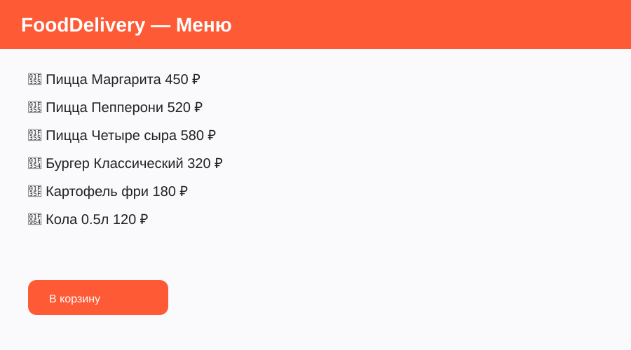
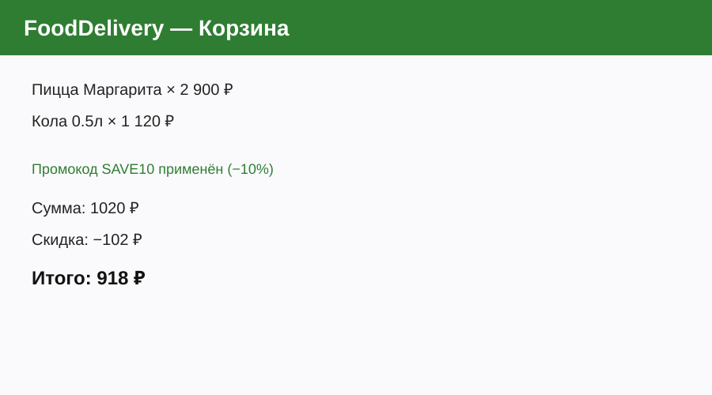
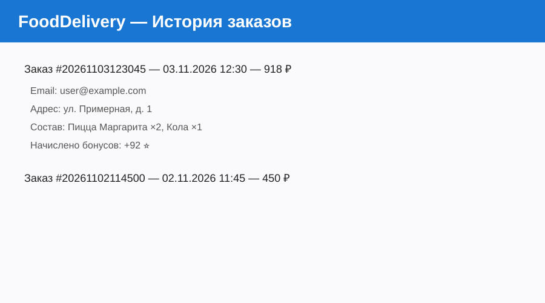
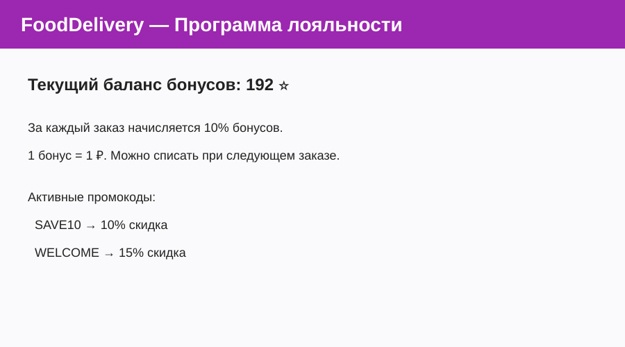

# Руководство пользователя FoodDelivery v2.0

## 1. Введение

**FoodDelivery v2.0** — учебное веб-приложение для заказа еды с доставкой.

**Для кого:** студенты, преподаватели, демонстрация заказчику.

**Как запустить:**

```bash
# Установка зависимости (один раз)
pip install streamlit

# Запуск приложения
streamlit run app.py
```

После запуска откроется браузер по адресу `http://localhost:8501`.

---

## 2. Быстрый старт

Сценарий «первая польза за 3 минуты»:

1. Откройте раздел **Меню**.
2. Добавьте в корзину 1–2 блюда (кнопка «В корзину»).
3. Перейдите в **Корзину**.
4. Введите промокод `SAVE10` и нажмите «Применить».
5. Заполните email и адрес доставки.
6. Нажмите **Оформить заказ**.

Готово! Заказ создан, бонусы начислены.



---

## 3. Основные функции

### 3.1. Меню и корзина

1. В боковой панели нажмите **Меню**.
2. Выберите категорию (Пицца, Бургеры, Напитки и т.д.).
3. Нажмите **В корзину** у нужного блюда.
4. Перейдите в раздел **Корзина**.
5. При необходимости уменьшите количество кнопкой «➖».
6. Введите промокод (`SAVE10` или `WELCOME`) и примените его.
7. Заполните email и адрес.
8. При наличии бонусов можно списать часть суммы.
9. Нажмите **Оформить заказ**.

**Ожидаемый результат:** появляется сообщение об успешном создании заказа и начислении бонусов. Корзина очищается.



### 3.2. История заказов

1. В боковой панели нажмите **История заказов**.
2. Вы увидите список всех прошлых заказов с датой и суммой.
3. Раскройте любой заказ, чтобы увидеть детали: состав, адрес, скидку, начисленные бонусы.

**Ожидаемый результат:** отображается полная история с возможностью просмотра деталей каждого заказа.



### 3.3. Программа лояльности

1. В боковой панели нажмите **Программа лояльности**.
2. Здесь отображается текущий баланс бонусов.
3. За каждый заказ автоматически начисляется **10%** от суммы заказа (после скидки) в виде бонусов.
4. 1 бонус = 1 ₽. Бонусы можно списать при следующем оформлении заказа.

**Активные промокоды:**

| Промокод | Скидка |
|----------|--------|
| SAVE10   | 10%    |
| WELCOME  | 15%    |



---

## 4. FAQ

**В: Как запустить приложение?**  
О: Установите Streamlit (`pip install streamlit`) и выполните `streamlit run app.py`.

**В: Где хранятся данные?**  
О: Заказы — в файле `orders.json`, баланс бонусов — в `bonus.json`. Данные сохраняются между запусками.

**В: Можно ли использовать бонусы и промокод одновременно?**  
О: Да. Сначала применяется промокод, затем можно списать бонусы с оставшейся суммы.

**В: Что будет, если я закрою браузер?**  
О: Данные заказов и бонусов сохраняются на диске. Корзина (текущая сессия) сбрасывается.

**В: Есть ли мобильная версия?**  
О: Пока нет. Это ограничение текущего спринта (см. планы в RETROSPECTIVE.md).

**В: Как сбросить все данные?**  
О: Удалите или очистите файлы `orders.json` и `bonus.json`.
