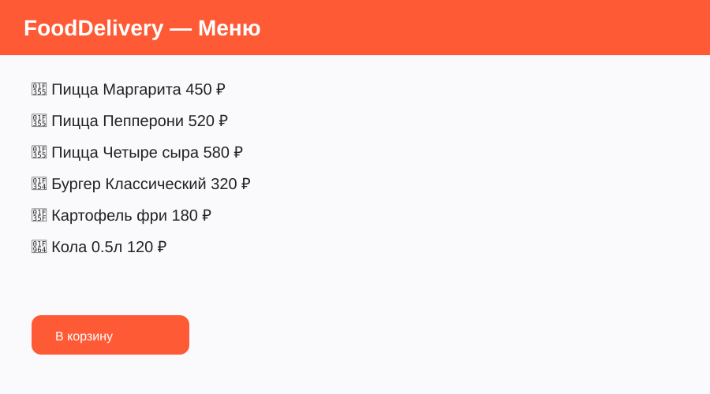
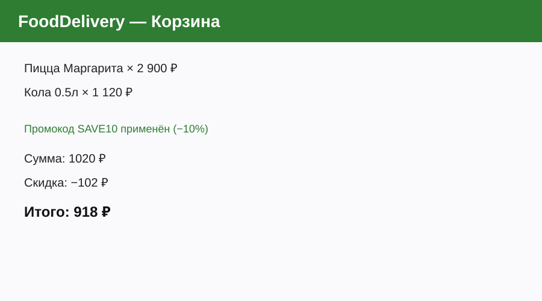

# FoodDelivery v2.0
## Демонстрация для заказчика
### Спринт 2 · Финальная стадия проекта

---

# Проблема

Заказ еды — это всё ещё неудобно:
- Долго выбирать и оформлять
- Нет прозрачной истории заказов
- Бонусные программы часто «непрозрачны»
- Промокоды работают непредсказуемо

Пользователь хочет быстро, понятно и с выгодой.

---

# Решение

**FoodDelivery v2.0** — простой и понятный сервис заказа еды:

- Удобное меню с категориями
- Корзина + промокоды в один клик
- История всех заказов
- Прозрачная программа лояльности (10% бонусов)
- Мгновенное оформление

---

# Демонстрация: 3 ключевых сценария

### 1. Оформление заказа
Добавляем пиццы и напиток → применяем промокод SAVE10 → оформляем заказ → получаем бонусы.

### 2. История заказов
Открываем историю → видим все прошлые заказы с датами, суммами и деталями.

### 3. Программа лояльности
Проверяем баланс бонусов → видим, как начисляются 10% → можем списать при следующем заказе.

---

# Метрики и достижения Спринта 2

| Показатель              | Значение |
|-------------------------|----------|
| Новые функции           | 2 (история + лояльность) |
| Исправлено багов        | 3        |
| Создано документов      | 4        |
| Промокоды               | 2 рабочих |
| Время оформления заказа | < 1 мин  |

---

# Известные ограничения (честно)

- Данные хранятся в JSON (нет базы данных)
- Нет мобильной версии / адаптивной вёрстки под телефон
- Нет реальной интеграции с платёжными системами
- Нет уведомлений (email/SMS/push)
- Нет авторизации пользователей

Всё это вынесено в бэклог Спринта 3.

---

# Планы на Спринт 3

1. Подключить PostgreSQL вместо JSON
2. Разработать мобильную (адаптивную) версию
3. Интегрировать простую платёжную систему (или mock)
4. Добавить email-уведомления о статусе заказа
5. Написать Unit-тесты для критических функций

---

# Call to Action

Все материалы проекта находятся в GitHub-репозитории:

**https://github.com/Nikolaj-Python/food-delivery-v2-Nikolaj**

- Код приложения
- Руководство пользователя
- Ретроспектива
- Release v2.0.0

Спасибо за внимание! Готовы ответить на вопросы.
